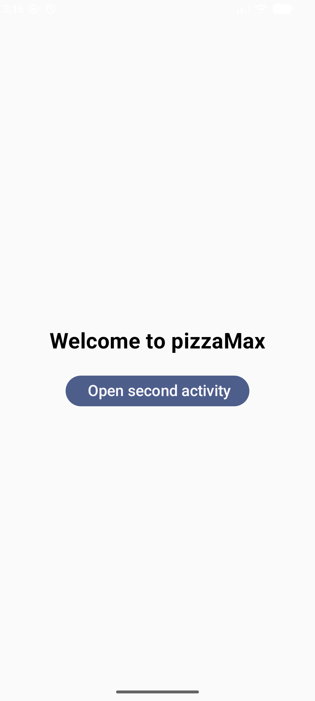
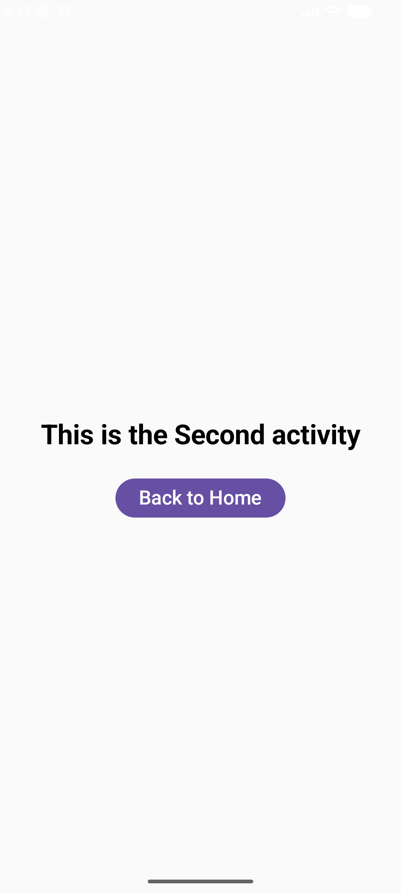

# 🍕 PizzaMax - Android Application

## 📌 About the Project

PizzaMax is a simple Android application developed using Kotlin and Jetpack Compose.

This project demonstrates basic Android Activity navigation, including opening a second screen and returning to the main screen.

## ✨ Features

- Welcome screen with a bold heading.
- Button to navigate from the main screen to the second screen.
- Centered text on the second screen.
- Back to Home button to return to the main screen.
- Simple and user-friendly interface.

## 🛠️ Technologies Used

- Kotlin
- Android Studio
- Jetpack Compose
- Git and GitHub

## 📱 Screenshots

### 1. Main Activity

The main screen displays a welcome message and a button to open the second screen.

<p align="center">
  
</p>

### 2. Second Activity

The second screen displays a message and a button to return to the main screen.

<p align="center">
  
</p>

## 📂 Project Structure

```text
PizzaMax/
├── app/
│   └── src/
│       └── main/
│           ├── java/
│           │   └── com/example/pizzamax/
│           │       ├── MainActivity.kt
│           │       └── SecondActivity.kt
│           ├── res/
│           └── AndroidManifest.xml
├── screenshots/
│   ├── pizzaMax01.png
│   └── pizzaMax02.png
├── README.md
├── build.gradle.kts
└── settings.gradle.kts
